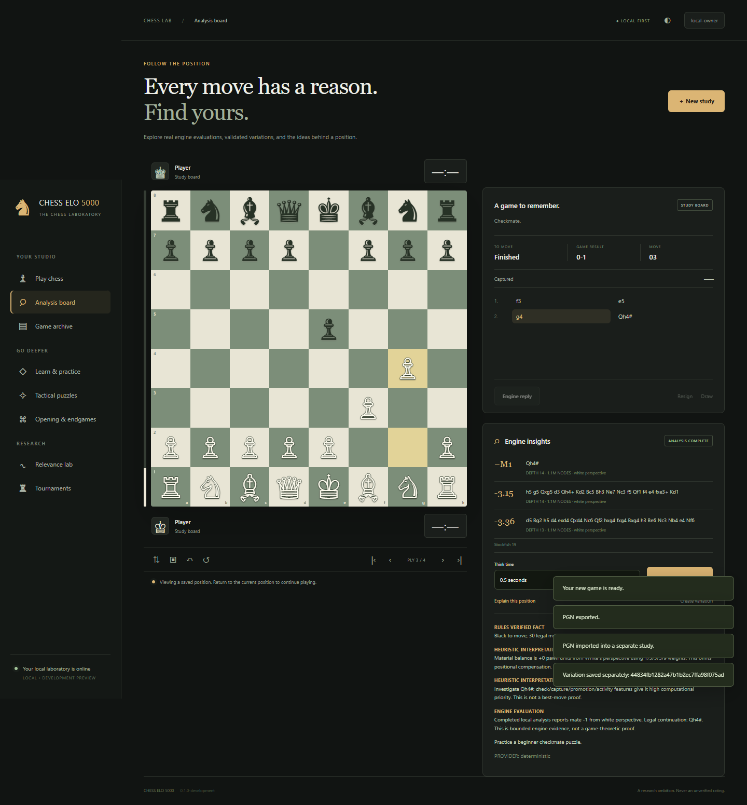

# ♟ CHESS ELO 5000

**An independent local chess application and experimental chess laboratory.**

Play legal chess against Stockfish 19, study saved games, solve interactive
exercises, and investigate which variations deserve more computation. The product
name is a research ambition, **not an achieved or official Elo rating**.

Version: `0.1.0-development` · Windows 11 x64 · PowerShell 7 · GPL-3.0-or-later.



## Play

Extract the Development ZIP, then run:

```powershell
pwsh -NoProfile -File .\Start-CHESS-ELO-5000.ps1
```

The launcher starts only this product's backend and isolated Joomla processes,
then opens the chess website. Existing installations are reused. First setup
requires installed Python 3.11–3.15 and XAMPP; the tested host uses Python 3.14.9,
PHP 8.5.12, Apache 2.4.65 and MariaDB 10.11.16. Development packages include the
unchanged Stockfish executable, its corresponding source, and offline dependency
wheels tested on Windows x64/Python 3.14. Source-only setup can obtain the pinned
official engine and Joomla distributions through the supplied installers.

The generated Joomla login is stored locally in
`runtime/private/joomla-access.json`. Sign in at the independent website; no
existing DRAGONHYDRA administrator account is adopted. Local credentials and
databases are excluded from Git and release archives.

| Local interface | Default address |
|---|---|
| Joomla chess website | http://127.0.0.1:18952/ |
| Joomla administrator | http://127.0.0.1:18952/administrator/ |
| Standalone chess client/API | http://127.0.0.1:18961/ |
| Independent MariaDB | Loopback port 18953, `chess_elo_5000_db` |

For Python-only use, run `Start-CHESS-ELO-5000.ps1 -Standalone`. Its local owner
password is generated in `runtime/private/config.json`. The backend package uses
this mode. Ports occupied by another application are refused. The Joomla installer
accepts explicit new site/port assignments for separate installations.

## Working capabilities

- Authoritative standard-chess rules, castling, en passant, all promotions,
  checkmate/stalemate, claimable and automatic draws, clocks and time forfeits.
- Human White or Black, real bounded local engine replies, persisted moves,
  duplicate/stale-response protection and exact restart reconstruction.
- Responsive click/drag/touch/keyboard board, legal highlights, rotation,
  captured pieces, history/replay, study undo, resignation and draw handling.
- Strict PGN import/export, FEN, annotations, archives and separate hypothetical
  variations that preserve the parent game.
- Stockfish UCI capability/options records, actual cp/mate evaluations and legal
  principal variations, analysis jobs, cancellation and configuration-bound cache.
- 23 playable lessons across four levels, 10 composed puzzles, five opening
  studies, eight endgame studies and persisted learning attempts/progress.
- Deterministic offline coach: rules-verified facts, labeled heuristics and
  matching completed engine evidence. Concrete variations are legally validated.
- Train/validation/held-out relevance experiments, four actual search-allocation
  methods, a frozen ridge policy, immutable evidence and negative results.
- Strict-node experimental negamax/alpha-beta search and paired, color-reversed
  engine configuration tournaments with explicit uncertainty and sample limits.
- Native Joomla component/template/package, administrator content revisions,
  settings, engine/job views and authenticated server-side bridge.

Ordinary gameplay uses no paid API, external reasoning model, GPU or sporting feed.
The application owns its source, SQLite state, Joomla identity and MariaDB data.

## Installation and development

```powershell
pwsh -NoProfile -File .\scripts\Install-ChessDependencies.ps1 -Development
pwsh -NoProfile -File .\scripts\Install-ChessEngine.ps1
pwsh -NoProfile -File .\scripts\Initialize-ChessDatabase.ps1
pwsh -NoProfile -File .\scripts\Install-JoomlaChess.ps1
```

Existing Stockfish is preserved. The engine installer verifies the official
archive SHA256 before extraction and refuses to overwrite an existing engine
directory. The source tree does not import any DRAGONHYDRA project directory.
The original En Croissant integration remains available through
`Start-Stockfish-GUI.ps1` when En Croissant is installed.

See [Joomla installation](docs/JOOMLA-INSTALLATION.md),
[client architecture](docs/CLIENT-IMPLEMENTATION.md),
[DRAGONHYDRA reuse matrix](docs/DRAGONHYDRA-REUSE-MATRIX.md),
[research method](docs/RESEARCH-METHOD.md), and
[third-party notices](THIRD-PARTY-NOTICES.md).

## Test and reproduce

```powershell
pwsh -NoProfile -File .\scripts\Test-Chess.ps1
pwsh -NoProfile -File .\scripts\Verify-ChessInstallation.ps1 -Live
pwsh -NoProfile -File .\scripts\Verify-JoomlaChess.ps1
pwsh -NoProfile -File .\scripts\Test-JoomlaChessDatabase.ps1
.\.venv\Scripts\python.exe .\scripts\benchmark_chess.py --engine-positions 100
```

Browser acceptance uses test-only Playwright and the installed Edge executable;
it does not install a browser. The reusable harness and pinned test dependency
are under `tests/`. Source, browser, database, package and release receipts are
delivered separately rather than inferred from implementation or a successful
version query. Observed failed attempts remain in the local verification evidence.

Build packages only from committed source:

```powershell
pwsh -NoProfile -File .\scripts\Build-ChessRelease.ps1
```

Artifacts include Development, Source, Python Backend, native Joomla Package and
Verification ZIPs, plus `MANIFEST.json` and `SHA256SUMS.txt`. The source ZIP includes
the complete product source and Stockfish corresponding source. Extracted-package
acceptance is mandatory before the proposed development prerelease is published.
No native desktop EXE or Setup EXE is advertised.

## Research and operational limits

The relevance dataset and composed tactical tournament are deliberately small.
Equal requested node budgets can produce different actual nodes and protocol
overhead. The experiments do not establish search superiority, calibrated
probabilities, general intelligence or a 5000 rating. Reference Stockfish analysis
is finite computation; it is not a proof of a position's game-theoretic value.

Syzygy files and optional local/external LLM providers are **UNCONFIGURED**. Endgame
studies use rules-verified lines and engine estimates, not unverified tablebase
claims. Opening frequencies are unavailable. This is a loopback development
preview using Flask's development server, not a public Internet production hosting
deployment. Windows native installers, OS-reboot/service installation, native
Linux/mobile applications and a complete advanced chess curriculum are outside
this first preview's verified scope.

Back up SQLite with `scripts/Backup-ChessState.ps1`; restore only into a new
runtime with `scripts/Restore-ChessState.ps1`. Joomla's independent database has
its own backup/restore verification scripts. Existing DRAGONHYDRA environments,
databases, services, histories and releases remain separate.
